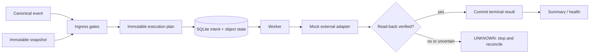

# Reliable Inquiry Orchestrator

A production-grade **reference implementation** for coordinating business workflows that contain irreversible external actions. It focuses on the hard parts: immutable plans, idempotency, bounded blast radius, explicit `UNKNOWN` handling, read-back verification, crash recovery, and scheduler leases.

> **Non-production source notice**
>
> This repository is an independently written, sanitized reference implementation informed by real-world engineering experience. It is **not** a copy of any employer's production source code. Company-specific integrations, data, selectors, credentials, deployment settings, business rules, and operational evidence are intentionally excluded. All external systems and sample data here are mocked.

## The engineering problem

Automation becomes risky when a timeout does not tell us whether an external action happened. Blind retrying can duplicate supplier messages, payments, workbook writes, or other irreversible effects. This project demonstrates a safer contract:

1. validate and freeze a snapshot;
2. create an immutable execution plan;
3. persist an intent before the side effect;
4. execute through an idempotent adapter;
5. verify by read-back;
6. commit a terminal result;
7. stop on `UNKNOWN` instead of guessing or retrying.

## Public reference vs. real production experience

| Area | Real-world experience represented | This public repository |
|---|---|---|
| Orchestration | Multi-object workflows and external side effects | Generic offline state machine |
| Integrations | ERP, messaging and workbook workflows | `MockExternalAction` only |
| Recovery | Checkpoints, immutable plans, reconciliation | SQLite-backed recovery protocol |
| Data | Operational records and evidence | Fictional `ORDER-*` examples |
| Deployment | Private production environment | Local CLI and tests only |

## Architecture



Detailed component and sequence diagrams are in [docs/architecture.md](docs/architecture.md).

## Key mechanisms

- Event idempotency: one canonical event maps to at most one plan.
- Immutable execution plan: exact ordered keys and a SHA-256 plan hash.
- Object-level state machine: planned → intent → confirmed/rejected/unknown.
- Side-effect protocol: reserve before action; never automatically retry `UNKNOWN`.
- Read-back verification: a successful call is not enough to claim completion.
- Blast-radius gate: reject a plan larger than the configured action limit.
- Snapshot gates: target, schema, age, key presence, and duplicate validation.
- Crash recovery: confirmed objects are skipped; unresolved intent fails closed.
- Scheduler lease: a single owner can run a named job until its lease expires.
- Bounded read retry: only explicitly transient read errors are retried.

## Safety design

The repository contains no network integration and cannot contact a real ERP, chat system, spreadsheet, or scheduler. Write outcomes are modeled as `CONFIRMED`, `REJECTED`, or `UNKNOWN`. The last state is terminal for automatic execution and requires reconciliation.

See [docs/failure-handling.md](docs/failure-handling.md) and [docs/decisions.md](docs/decisions.md).

## Run locally

```powershell
py -m venv .venv
.\.venv\Scripts\Activate.ps1
python -m pip install -e ".[dev]"
reliable-orchestrator
```

Example output:

```json
{
  "confirmed": 2,
  "noop": 0,
  "rejected": 0,
  "unknown": 0
}
```

## Test

```powershell
python -m pytest
python -m ruff check .
```

The published test count is the result from this repository only. It is deliberately kept separate from any historical production-project test count. The scenarios are documented in [docs/testing.md](docs/testing.md).

## Known limitations

- No real external-system connector is included.
- Reconciliation of an `UNKNOWN` outcome is represented as a deliberate manual boundary.
- SQLite is suitable for this reference; a distributed deployment would need a database with stronger multi-host lease semantics.
- Authentication, secrets management, deployment manifests, and production monitoring configuration are out of scope.

## Interviewer reading route

1. Read `src/reliable_orchestrator/engine.py` for the control flow.
2. Read `src/reliable_orchestrator/store.py` for persistence and idempotency.
3. Read `tests/test_orchestrator.py` for failure semantics.
4. Read `docs/decisions.md` for trade-offs.
5. Run the offline test suite and the mock CLI.

## Technology stack

- Python 3.10+
- SQLite
- pytest
- Ruff
- Standard-library dataclasses, enums, hashing, and JSON

## License

MIT. See [LICENSE](LICENSE).
